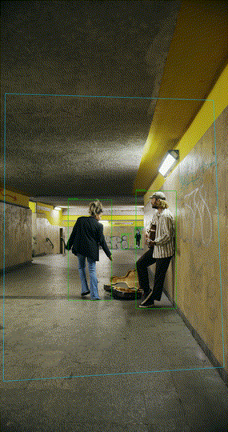

  

  

  
  
  
  

---

## 👋 About me

I'm **Abdulbasit**, a machine learning engineer and the founder of **Clyyde Technologies**, based in Abuja, Nigeria.

At Clyyde we're building **Starium**: AI that turns local-language radio, news and community reports into **verified early warnings**, so organisations in West Africa can keep their people out of harm's way.

- 🛰️ **Building:** Starium, AI early warning and threat intelligence
- 🎥 **Recent work:** real-time video analytics with YOLO11 + ByteTrack
- 🤖 **Skilled in:** machine learning, LangChain and agentic AI systems
- 🗣️ **Exploring:** speech-to-text and NLP for Hausa and other Nigerian languages
- 🌍 **Care about:** AI that works in African conditions: low-cost hardware, noisy data, local languages, and honest evaluation

---

## 🛠️ Tech stack

  

  
  
  
  
  
  
  
  

---

## 🧠 Skills

<table>
<tr>
<td valign="top" width="50%">

**🤖 LLMs & agentic AI**
- Building agentic AI systems: tool use, multi-step reasoning, workflows
- LangChain: chains, retrieval (RAG), agents
- Prompt design and LLM evaluation

**📈 Machine learning**
- Supervised and unsupervised learning, feature engineering
- Model training, validation and error analysis
- scikit-learn, PyTorch, TensorFlow

</td>
<td valign="top" width="50%">

**👁️ Computer vision**
- Object detection with Ultralytics YOLO11
- Multi-object tracking with ByteTrack
- Video analytics and zone/event logic with OpenCV

**🗣️ Language & speech AI**
- NLP with Hugging Face Transformers
- Speech-to-text (Whisper) for low-resource languages
- Hausa and Nigerian-language AI

**⚙️ Engineering**
- Python, FastAPI, Docker, Git, Linux

</td>
</tr>
</table>

---

## 🚀 Featured project

<table>
<tr>
<td width="55%" valign="top">

### [Dwell Detector](https://github.com/Sykoo00o/dwell-detector)
Zone-based **loitering alerts** for fixed-camera video. It detects and tracks people and vehicles, measures how long each stays inside a zone you draw, and raises an alert past a time threshold.

- **YOLO11 + ByteTrack + OpenCV**, runs on CPU (~12–24 FPS)
- Timestamped `enter / exit / loiter_alert` events, annotated video, run summary
- Tracker-tuning experiments and an honest **known limitations** section

</td>
<td width="45%" align="center">
  
</td>
</tr>
</table>

---

## 📊 GitHub activity

  
  

  

